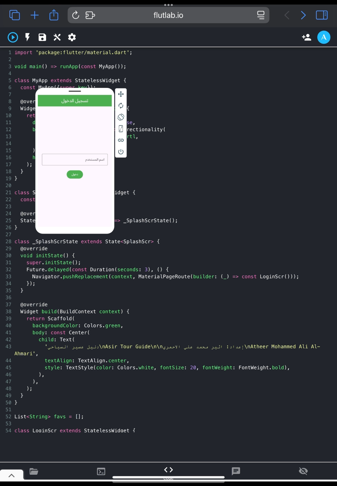
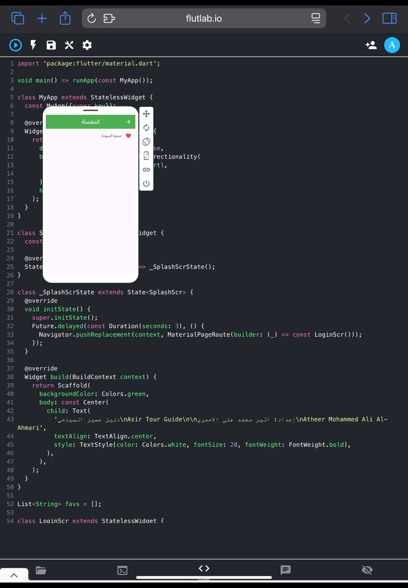

# AsirTourGuide

**إعداد الطالبة:** أثير محمد علي الأحمري

## فكرة التطبيق
تطبيق مرشد سياحي لمنطقة عسير مبني باستخدام Flutter يستعرض أبرز الوجهات السياحية والمعالم في عسير بأسلوب منظم وواجهة سهلة.

## قائمة الشاشات
- الشاشة الافتتاحية (Splash Screen): تعرض اسم التطبيق واسم الطالبة بالعربية والإنجليزية.
- تسجيل حساب جديد وتسجيل الدخول (Sign Up & Login): إنشاء حساب جديد وحفظ بيانات الحسابات مؤقتاً في الذاكرة أثناء التشغيل مع رسائل تنبيه في حال الحقول الفارغة أو تكرار اسم المستخدم أو خطأ بيانات الدخول.
- الشاشة الرئيسية / الأماكن السياحية (Home / Places): استعراض الوجهات السياحية في منطقة عسير.
- تفاصيل المكان (Place Details): عرض تفاصيل المكان المختار بعد تمرير بياناته من الشاشة الرئيسية.
- المفضلة (Favorites): عرض الأماكن المضافة إلى المفضلة.

## شرح عمل التطبيق والتنقل بين الشاشات
يبدأ التطبيق بالشاشة الافتتاحية ثم ينتقل إلى شاشة تسجيل الدخول أو إنشاء حساب جديد، وبعد التحقق من الدخول يتم التنقل بين الشاشات الرئيسية لتصفح الأماكن، والانتقال إلى شاشة تفاصيل المكان مع تمرير بياناته، وإضافة أو عرض العناصر في المفضلة.

## الميزة الإضافية وطريقة عملها
تنظيم المحتوى وعرض الوجهات السياحية وتفاصيلها وقائمة المفضلة بشكل تفاعلي وسلس عبر الشاشات (ويمكن توضيح أي ميزة إضافية أخرى مضافة مثل البحث أو التصفية أو الوضع الليلي حسب التطبيق).

## لقطات من التطبيق (Screenshots)

## فيديو استعراض التطبيق (Video)
[مشاهدة الفيديو على Google Drive](https://drive.google.com/file/d/18nk70CioKLwO54jSl2tH4ZaItZLO6o3L/view?usp=drivesdk)

---

# AsirTourGuide (English)

**Prepared by:** Atheer Mohammed Ali Al-Ahmari

## App Idea
A tourism guide application for the Asir region built with Flutter, showcasing key tourist destinations and attractions with a clear interface and smooth navigation.

## Screens List
- Splash Screen: Displays the app name and student name in Arabic and English.
- Sign Up & Login Screens: Create a new account and store account data temporarily in memory during runtime, with clear error messages for empty fields, duplicate usernames, or invalid credentials.
- Home / Places Screen: Displays tourist destinations in the Asir region.
- Place Details Screen: Shows details of the selected place passed from the previous screen.
- Favorites Screen: Displays saved favorite places.

## App Workflow & Navigation
The app starts with the Splash Screen, moves to Sign Up or Login, and after authentication navigates across the app screens while passing selected place data to the details view and managing favorites.

## Additional Feature & How It Works
Structured multi-screen navigation and interactive browsing of Asir destinations, place details, and favorites (update this section if you added search, filtering, dark mode, or another extra feature).

## App Screenshots

## Demo Video
[Watch Video on Google Drive](https://drive.google.com/file/d/18nk70CioKLwO54jSl2tH4ZaItZLO6o3L/view?usp=drivesdk)
